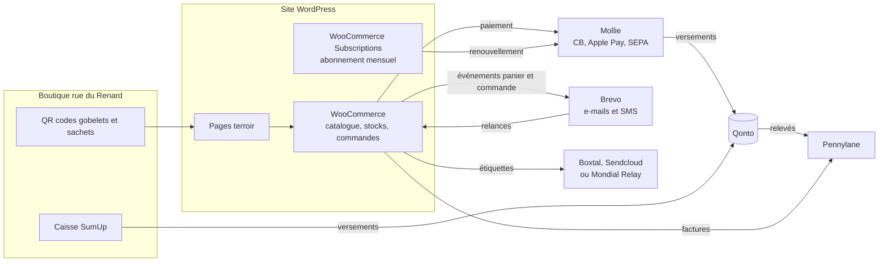
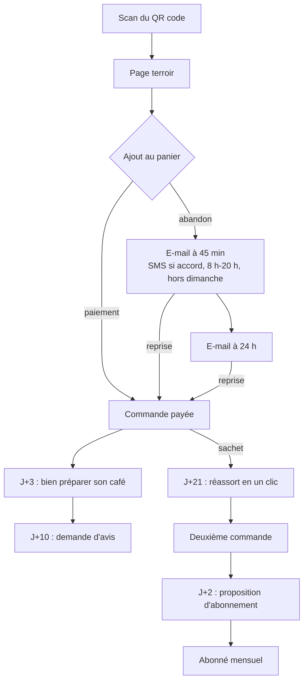

# E-shop Yem'kaf : schémas

Schémas Mermaid de l'architecture (affichés automatiquement sur GitHub). La version illustrée, avec les textes des
e-mails et SMS, est dans [`index.html`](index.html).

## Flux entre les outils

## Parcours client et relances

